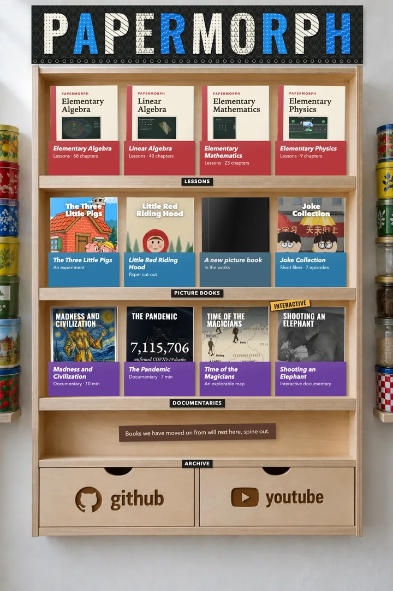
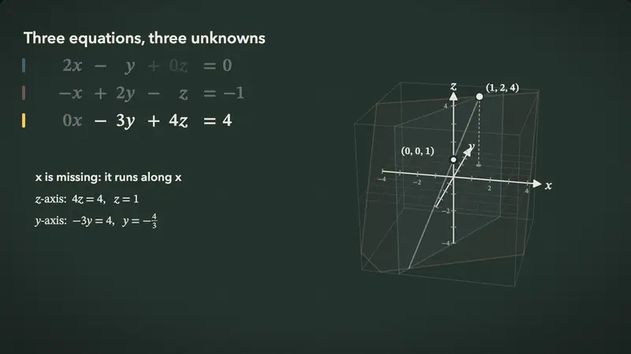
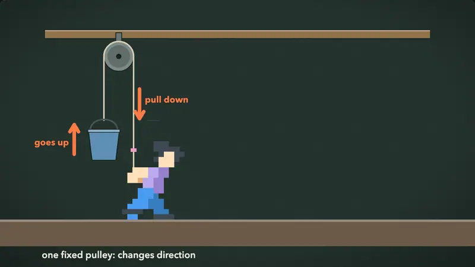
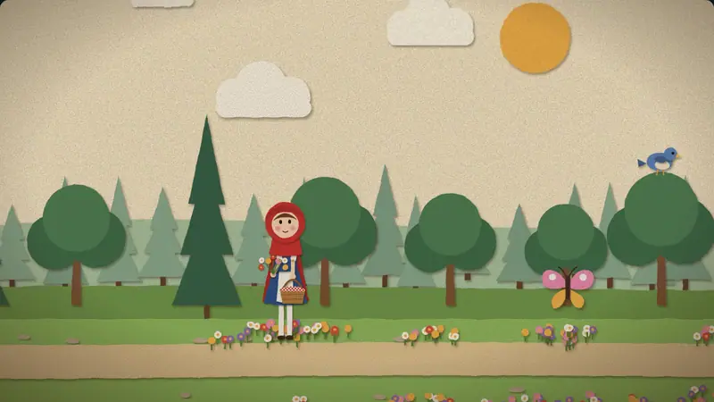
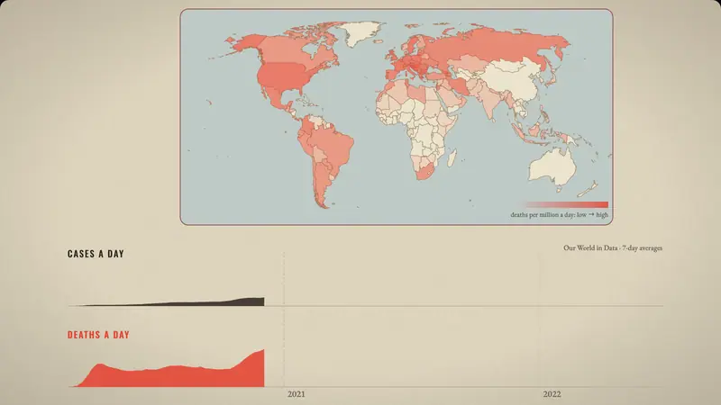
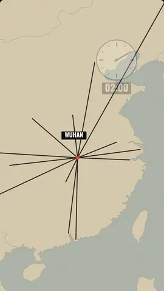
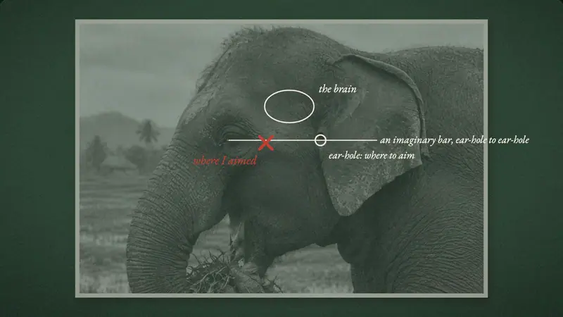
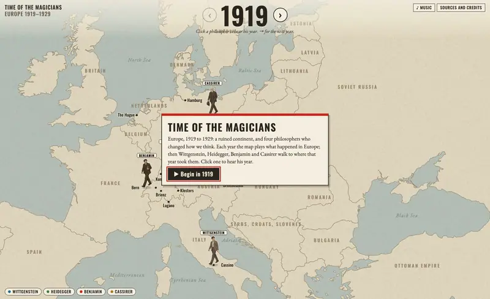

<p align="center">
  <a href="https://papermorph.diamonddoge.org/">
    
  </a>
</p>

<p align="center">
  <strong>An agent skill that turns textbooks into narrated, interactive web lessons,<br>stories into paper-puppet films, and books into documentaries, upright shorts and pages you explore.</strong>
</p>

<p align="center">
  <a href="https://papermorph.diamonddoge.org/">Open the live bookshelf →</a>
  ·
  <a href=".claude/skills/papermorph/SKILL.md">Read the Skill →</a>
  ·
  <a href="https://papermorph.diamonddoge.org/work/">Work with us</a>
</p>

> **1,000 stars.** Thank you to everyone who starred Papermorph, tried the Skill, filed issues and sent pull requests. The first roadmap is done; the next is [below](#roadmap).

Everything is a static web page: no server, no database, no account. A book is a folder you can host anywhere.

## On the shelf

### Lessons, from a textbook PDF

Formulas, diagrams and scenes change step by step as the narration explains, with quick checks and chapter practice that grade the maths, not the string.
[Elementary Algebra](https://papermorph.diamonddoge.org/elementary-algebra/) (68 chapters) · [Linear Algebra](https://papermorph.diamonddoge.org/linear-algebra/) (40, planes you can drag in 3D) · [Elementary Mathematics](https://papermorph.diamonddoge.org/math-notebook/) (23) · [Elementary Physics](https://papermorph.diamonddoge.org/science/) (9)

<p align="center">
  <a href="https://papermorph.diamonddoge.org/linear-algebra/ch12/"></a>
  <a href="https://papermorph.diamonddoge.org/science/ch12/"></a>
</p>

### Picture books, from a story, a joke or a fairy tale

Paper puppets in front of sets drawn in code or painted by an image model, with voices, subtitles, sound effects, music and camera work. Young readers can tap things in the picture to hear their names.
[Joke Collection](https://papermorph.diamonddoge.org/joke-collection/) (7 episodes) · [Little Red Riding Hood](https://papermorph.diamonddoge.org/little-red-riding-hood/)

<p align="center">
  <a href="https://papermorph.diamonddoge.org/joke-collection/ch03/"></a>
  <a href="https://papermorph.diamonddoge.org/little-red-riding-hood/ch01/"></a>
</p>

### Documentaries and upright shorts, from a book or an idea

Public-domain engravings, paintings, maps and charts, moved in step with the voice, with music. A documentary can be recut as a series of upright shorts for a phone feed.
[Madness and Civilization](https://papermorph.diamonddoge.org/madness/) (10 minutes, and 4 shorts) · [The Pandemic](https://papermorph.diamonddoge.org/pandemic/) (7 minutes, 6 shorts and a scroll story)

<p align="center">
  <a href="https://papermorph.diamonddoge.org/pandemic/ch01/"></a>
  <a href="https://papermorph.diamonddoge.org/pandemic-shorts/ch01/"></a>
</p>

### Pages you play

A film can stop and hand the reader the next move, and a map can be walked a year at a time.
[Shooting an Elephant](https://papermorph.diamonddoge.org/shooting-an-elephant/) (Orwell's essay; you hold the rifle) · [Time of the Magicians](https://papermorph.diamonddoge.org/time-of-the-magicians/) (Europe 1919–1929, four philosophers on the map)

<p align="center">
  <a href="https://papermorph.diamonddoge.org/shooting-an-elephant/"></a>
  <a href="https://papermorph.diamonddoge.org/time-of-the-magicians/"></a>
</p>

## Get started

Install the Skill in your project, for Claude Code or OpenCode:

```bash
npx skills add DozenTwelve/Papermorph --skill papermorph --agent claude-code   # or --agent opencode
```

Then type `/papermorph`. It finds the PDF in your project (or asks for your story), tells you what kind of book it is, suggests a chapter to try first and how much animation it needs, and offers a recommended option at every step. Your choices are saved in `style.json`, so every later chapter is made to the same style.

In OpenCode, a clone of this repository already has the command (`.opencode/commands/papermorph.md`) and the Skill; with a global install, copy that file to `~/.config/opencode/commands/`.

You need [uv](https://docs.astral.sh/uv/), ffmpeg, and Playwright's browsers (`uv run --with playwright playwright install chromium firefox`). Narration uses Edge TTS (online) or Kokoro (local), free. A few steps are paid, optional and need an API key: painted sets for picture books (OpenRouter or OpenAI), and ElevenLabs narration and clips made from a still for documentaries ([OpenRouter](https://openrouter.ai/)).

## How it works

A book is planned before it is drawn: chapters or scenes, then a script, then a storyboard. The narration is voiced and every word gets a time, and the picture is animated to those times. The model then watches its own output (contact sheets, overlap and blank-frame checks, end-to-end tests, a director's review against approved books) and fixes what it sees. Large chapters are made by a team of subagents, each step on the model you choose ([core/team.md](.claude/skills/papermorph/references/core/team.md)). The books on the shelf were made with Opus 5.5, GPT-6.1-Sol and Sonnet 5.5; an illustrated physics chapter costs about $10–18 of model usage.

Every book plays in the same player: pause anywhere, step back and forth, speed, captions, keyboard shortcuts, and progress saved per book, with the interface in English, Russian, Chinese or Japanese. The player lives in [`engine/`](engine) and every book keeps its own copy, so a book never breaks when the engine changes; `scripts/engine.py site` updates them from the latest release (`--from you/your-fork@main` from your own).

Any chapter or episode also renders to a 1080p MP4 with an `.srt`, frame by frame from the lesson clock (`scripts/export.py`), and a book can be packaged for an LMS as SCORM (`scripts/scorm.py`, [courses.md](.claude/skills/papermorph/references/lessons/courses.md)).

## Roadmap

The first roadmap is done: maths books, science books, picture books, a model of your choice for every step, documentaries, and upright shorts. Point-and-read, a rifle, a map and a scroll story came along the way. Next:

- **Picture books for children who can't read yet.** New looks besides paper cut-outs, still moved in code, and more ways to play inside the film by voice and touch: find the thing the narrator names, tap to make the story go on, choose by picture.
- **Picture books from a PDF of pictures.** Bring an illustrated book and make its pages move: tap to hear names over the painting, layers that drift in parallax, characters cut into paper puppets, the printed text read aloud. For your own books or a publisher's; our own examples will use public-domain books or pictures we draw.
- **Lessons with their own examples.** The textbook sets what is taught, in what order and how hard; the Skill writes new worked examples and exercises, with answers computed in code, so nothing is copied from the book.
- **One source, every shape.** A single Wikipedia article made into a documentary, shorts, an interactive page and a scroll story, side by side.
- **Elementary Physics, remade** with what the newer books can do.

## Working with us

The shelf is a set of examples: the shapes that suit a maths book, a language course, a picture book or a documentary, and one source can take several of them (*The Pandemic* is a film, six shorts and a scroll story). For publishers, schools and studios we build the pipeline around your own titles and your own style. See [the work page](https://papermorph.diamonddoge.org/work/), or write to [a972848363@gmail.com](mailto:a972848363@gmail.com) with what the titles are, who they are for, and how many you have in mind.

## FAQ

**How is this different from Claude Motion?** [Claude Motion](https://claude.com/resources/articles/dashboards-and-motion) makes animated explainers. Papermorph makes whole books: many chapters in one consistent style, quizzes that are graded, progress that is saved, and a static site you own and can host anywhere.

**Can I make a book from any PDF?** Yes, for your own use. The finished book contains new explanations and drawings, not the PDF's pages, but publishing a book based on someone else's textbook is your call to check.

## Contributing

Fixes to the Skill and the player are welcome. Please don't open pull requests that add a copyrighted book, its PDF, or lessons made from one. Agents and people changing the repository: start with [AGENTS.md](AGENTS.md).

To try the examples locally:

```bash
git clone --depth 1 https://github.com/DozenTwelve/Papermorph.git
cd Papermorph
python3 .claude/skills/papermorph/scripts/serve.py 8765 site   # then open http://localhost:8765/
```

## License

[MIT](LICENSE). The bundled MathJax (`engine/vendor/mathjax`) is under the Apache License 2.0. The MIT licence covers the code. Pictures, recordings and data under `site/` keep their own licences, listed beside them (for example `site/pandemic/img/SOURCES.md`); toned copies of CC BY-SA pictures stay CC BY-SA.
