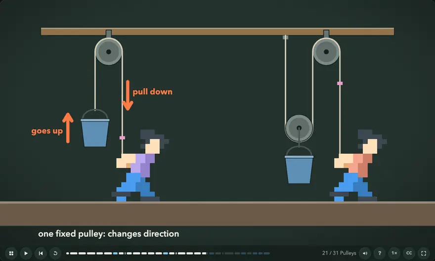
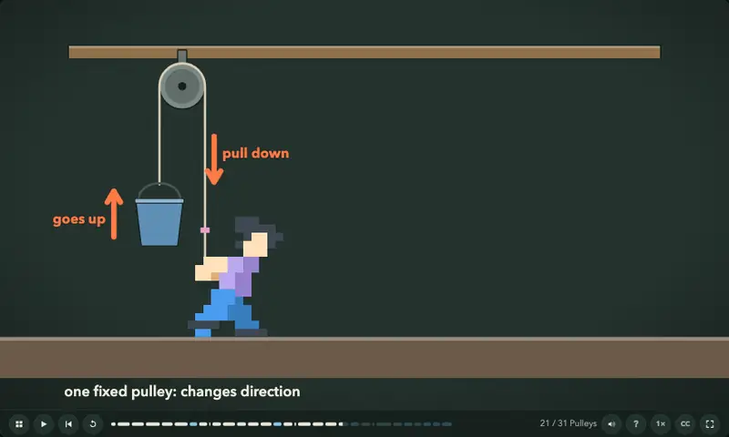
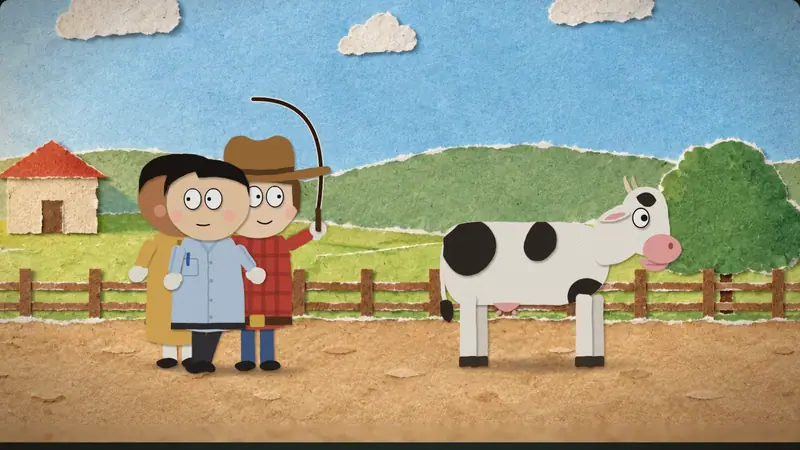

<p align="center">
  <picture>
    <source media="(prefers-color-scheme: dark)" srcset="img/readme/logo_light.png">
    <source media="(prefers-color-scheme: light)" srcset="img/readme/logo.png">
    
  </picture>
</p>

<p align="center">
  <strong>A Claude Code Skill that turns textbooks into narrated, interactive web lessons,<br>and stories into paper-puppet films.</strong>
</p>

<p align="center">
  <a href="https://papermorph.diamonddoge.org/">Open the live bookshelf →</a>
  ·
  <a href=".claude/skills/papermorph/SKILL.md">Read the Skill</a>
</p>

<p align="center">
  <a href="https://papermorph.diamonddoge.org/">
    
  </a>
</p>

## What you can make

| You give it | You get | On the shelf |
|---|---|---|
| A textbook PDF (maths) | Lessons where formulas and diagrams change step by step as the narration explains, with quick checks and chapter practice that grade the maths, not the string | [Elementary Algebra](https://papermorph.diamonddoge.org/elementary-algebra/) (68 chapters), [Elementary Mathematics](https://papermorph.diamonddoge.org/math-notebook/) (23) |
| A textbook PDF (science) | Illustrated scenes with acting characters and camera work, plus the same quizzes | [Elementary Physics](https://papermorph.diamonddoge.org/science/) (9 chapters and a sample) |
| A story, a joke or a fairy tale | A short film of paper puppets in front of sets drawn in code or painted by an image model, with voices, subtitles, sound effects and music | [Joke Collection](https://papermorph.diamonddoge.org/joke-collection/) (7 episodes), [Little Red Riding Hood](https://papermorph.diamonddoge.org/little-red-riding-hood/) |

<p align="center">
  <a href="https://papermorph.diamonddoge.org/science/ch12/"></a>
  <a href="https://papermorph.diamonddoge.org/joke-collection/ch03/"></a>
</p>

Everything is a static web page: no server, no database, no account. A book is a folder you can host anywhere.

## Get started

Install the Skill in your project:

```bash
npx skills add DozenTwelve/Papermorph --skill papermorph --agent claude-code
```

Then, in Claude Code:

```text
/papermorph
```

It finds the PDF in your project (or asks for your story), tells you what kind of book it is, suggests a chapter to try first and how much animation it needs, and offers a recommended option at every step. Your choices are saved in `style.json`, so every later chapter is made to the same style.

You need [uv](https://docs.astral.sh/uv/), ffmpeg, and Playwright's browsers (`uv run --with playwright playwright install chromium firefox`). Narration uses Edge TTS (online) or Kokoro (local). Painted sets for picture books need an image-model API key; everything else runs without one.

## How it works

**Textbooks:** the PDF is split into chapters → each chapter gets a beat plan and narration → the narration is voiced, and every word gets a time → the picture is laid out as a storyboard first, then animated in time with those words → quizzes go between the steps → the model watches its own output (contact sheets, overlap and blank-frame checks, end-to-end tests) and fixes what it sees.

**Picture books:** your telling becomes a script and a shot list → puppets and sets are built (or painted) once and reused across episodes → voices, mouth shapes, sound effects and music are made and joined per scene → scenes are filmed in parallel → review rounds (a director, picture reviewers and a sound reviewer) send scenes back until they hold up next to approved episodes.

Large chapters can be made by a team of subagents, each step on the model that suits it ([team.md](.claude/skills/papermorph/references/team.md)).

## The player

Every book plays in the same player: pause anywhere, step back and forth, click a step to jump there, speed control, captions, keyboard shortcuts, and progress saved per book. Interface text follows the book's language (`<html lang>`: English, Russian, Chinese and Japanese are built in); foreign lines in a film are subtitled. Formulas can be written in LaTeX (MathJax, copied only into the books that use it).

The player engine lives in [`engine/`](engine), apart from the Skill, and every book keeps its own copy, so a book never breaks when the engine changes. To update the books, or to use your own fork:

```bash
python3 .claude/skills/papermorph/scripts/engine.py site                          # sync every book in site/
python3 .claude/skills/papermorph/scripts/engine.py site --from you/your-fork@main
```

Engine versions are tagged. Since `engine-v2` the maths helpers (number lines, tiles, planes, the number-set diagram) are in `lib/math.js`: a chapter that uses them loads `../lib/math.js` right after `engine.js`, and `lint.py` names the chapters that need it. `--from DozenTwelve/Papermorph@engine-v1` keeps the earlier engine.

## Video and LMS export

With the site served locally, any chapter or episode renders to a 1080p MP4 with an `.srt`:

```bash
uv run --with playwright --with numpy .claude/skills/papermorph/scripts/export.py ch12 \
  --url http://localhost:8765/science/ --link https://papermorph.diamonddoge.org/science/ch12/
```

Frames are rendered from the lesson clock, so the video matches the page exactly; quizzes stay in the interactive version, and the video ends by pointing there.

For courses, a book can also be packaged for an LMS as SCORM 1.2 or 2004 (`scripts/scorm.py`), and a book can opt in to verified citation links and reviewed question banks ([authoring.md](.claude/skills/papermorph/references/authoring.md)). None of this is on by default.

## Models and cost

The Skill is not tied to one model: the books on the shelf were made with Opus 5.5, GPT-6.1-Sol and Sonnet 5.5.

An illustrated physics chapter costs about $10–18 of model usage. The painted sets of a picture-book episode cost under $0.20.

## Roadmap

- [x] **Maths books:** formulas and diagrams that change step by step, with quizzes.
- [x] **Science books:** illustrated scenes, acting characters, camera work.
- [x] **Picture books:** paper-puppet films from a story, a joke or a fairy tale.
- [ ] **Choosing the model for every step**, with defaults that depend on how much animation a book needs.
- [ ] **Documentaries:** history and social-science titles.

## FAQ

**How is this different from Claude Motion?** [Claude Motion](https://claude.com/resources/articles/dashboards-and-motion) makes animated explainers. Papermorph makes whole books: many chapters in one consistent style, quizzes that are graded, progress that is saved, and a static site you own and can host anywhere.

**Can I make a book from any PDF?** Yes, for your own use. The finished book contains new explanations and drawings, not the PDF's pages, but publishing a book based on someone else's textbook is your call to check.

## Contributing

Fixes to the Skill and the player are welcome. Please don't open pull requests that add a copyrighted book, its PDF, or lessons made from one.

## Try the examples locally

```bash
git clone --depth 1 https://github.com/DozenTwelve/Papermorph.git
cd Papermorph
python3 .claude/skills/papermorph/scripts/serve.py 8765 site
```

Then open [localhost:8765](http://localhost:8765/). (The full history is large; `--depth 1` skips it.)

## License

[MIT](LICENSE). The bundled MathJax (`engine/vendor/mathjax`) is under the Apache License 2.0.
